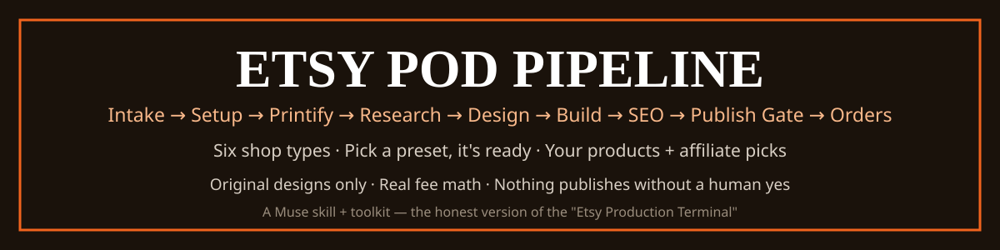

<p align="center">
  
</p>

<p align="center">
  <a href="LICENSE"></a>
  
  
  
  
  
</p>

<h1 align="center">Etsy POD Pipeline</h1>

<p align="center">
  <strong>The whole Etsy pipeline, mapped end to end — for a shop you already have.</strong><br>
  Six shop types ship as ready-made presets: pick one and the pipeline is pre-configured —
  products, research-backed price bands, pricing and listing configs, launch checklist.
  A tested pricing calculator that runs Etsy's <em>real</em> fee stack, and a listing-pack
  generator built to Etsy's <em>actual</em> SEO rules. Original designs only.
  A human approves every publish.
</p>

---

## What this is

A complete, honest system for running an Etsy shop with an AI
agent's help — the way it actually works, not the way reels say it
works. It starts from the shop you already have, covers **six shop
types** (print-on-demand apparel, pet accessories, digital
design/pattern downloads, digital templates, original 3D-print
files, coloring books), and runs every product through eight
stages: setup health check, Printify connection (physical types),
research with a scored due-diligence system, original design,
building and pricing with the full fee stack, listing packs built
to Etsy's current Seller Handbook SEO guidance, publishing **only
behind a human approval gate**, and weekly orders-and-care.

Every shop also runs the **mixed model**: your own products on
Etsy, plus **affiliate picks** — proven third-party products in
your niche, promoted off Etsy (never inside it) for commission.
The rules for that lane are documented as carefully as the fees,
because both will close accounts when ignored
([`docs/affiliate-model.md`](docs/affiliate-model.md)).

It was inspired by a viral "AI ecosystem" reel showing an "Etsy
Production Terminal" with a five-figure revenue counter. The stages
here are the real version of that terminal — including the parts
the reel didn't show: fees, IP law, QC, and the publish gate. See
**Honest limits** below before you believe anything, including us.

## ❓ Start here — the intake

The pipeline asks two questions and branches on the answers
(Stage 1, [`docs/01-shop-setup.md`](docs/01-shop-setup.md)):

1. **Do you already have an Etsy shop?** Assumed **yes** — Stage 1
   is a health check on the shop you have (payments, policies,
   production partners, currency). If the answer is no, the
   one-time creation walkthrough lives in
   [`docs/appendix-shop-creation.md`](docs/appendix-shop-creation.md)
   — your hands only — and then you come back.
2. **Do you already have a product?** If yes — including a whole
   POD business from elsewhere — the pipeline brings it into Etsy:
   niche re-validated against Etsy demand, listing rebuilt to
   Etsy's SEO standard. **If no, the pipeline creates one with
   you**: every preset carries a `creation_path` — research →
   design brief → original production to spec → priced → listing
   pack with the full SEO treatment → slotted into your shop
   behind the publish gate.

Then pick your shop type (below) and go.

## ⚡ Quickstart

```bash
git clone <this-repo-url> etsy-pod-pipeline
cd etsy-pod-pipeline
./setup.sh
python3 -m pipeline.presets          # pick a shop type first
python3 -m pytest                    # the math, the limits, the presets
python3 -m pipeline.pricing config/pricing.example.json
python3 -m pipeline.listing config/design-brief.example.json
```

## 🧭 Pick a shop type first

Six shop types ship as ready-made presets — niche brief, starter
products, research-backed price bands, a pricing config and a
listing brief the tools below consume, affiliate picks, a creation
path, and a launch checklist. Pick one and the pipeline is
pre-configured for that shop (full map:
[`docs/shop-types.md`](docs/shop-types.md)):

```bash
python3 -m pipeline.presets                    # the list
python3 -m pipeline.presets pet-accessories    # one preset, in full
python3 -m pipeline.presets pet-accessories --emit # write its configs
```

| Preset | Shop | Delivery |
|---|---|---|
| `pod-apparel` | Print-on-demand apparel (RiseOrConquer starter included) | Printify, per order |
| `pet-accessories` | Personalised pet accessories (no food — ever) | Printify / disclosed partner |
| `digital-downloads` | SVG / pattern / printable design assets | Instant download |
| `digital-templates` | Planners, resumes, business documents | Instant download (Canva link / files) |
| `stl-files` | Original 3D-print files (Blender-modelled) | Instant download |
| `coloring-books` | Printable coloring books in narrow themes | Instant download (PDF) |

Then pick your path — full details in [INSTALL.md](INSTALL.md):

- **With an agent (recommended):** point it at [`SKILL.md`](SKILL.md),
  answer the intake, and name your shop type and niche. It walks
  the eight stages with you, doing the preparable work and
  stopping at every human-only step.
- **By hand:** start at [`docs/01-shop-setup.md`](docs/01-shop-setup.md)
  and work the checklists in order.

## 🗺️ Workflow map — intake + the eight stages

```mermaid
flowchart LR
    Q["0 · INTAKE<br/>❓ shop? product?<br/>pick a preset — 6 built in"] --> A["1 · EXISTING SHOP<br/>🧍 health check<br/>payments · policies · partners"]
    A --> B["2 · CONNECT PRINTIFY<br/>physical types only<br/>token via connect flow — never in chat"]
    B --> C["3 · RESEARCH<br/>due diligence + scoring<br/>validated niche ✓ copied artwork ✗"]
    C --> D["4 · DESIGN / CREATE<br/>original work to spec<br/>the creation path lives here"]
    D --> E["5 · BUILD PRODUCTS<br/>price = full fee stack<br/>calculated, not guessed"]
    E --> F["6 · LISTING SEO<br/>title ≤140 · 13 tags × 20 chars<br/>Etsy's 2026 rules, audited"]
    F --> G{"7 · PUBLISH GATE<br/>human approves THIS<br/>product + THIS pack"}
    G -->|no| D
    G -->|yes| H["8 · ORDERS & CARE<br/>fulfilment runs · you watch<br/>messages · reviews · weekly loop"]
    H -.-> M["MIXED MODEL<br/>affiliate picks promoted<br/>OFF Etsy — never inside it"]
```



1. **Start from your existing shop** (`docs/01-shop-setup.md`) —
   the intake (shop? product? shop type?) and a health check:
   Etsy Payments active, bank verified, policies set, production
   partners disclosed, currency matched. Shop creation, for the
   minority who need it, is an appendix — identity, banking, and
   tax are the human's hands, always.
2. **Connect Printify** (`docs/02-connect-printify.md`) — physical
   types only: API token via the connect flow (never in chat,
   never in this repo), Etsy linked as a sales channel, a
   Canada/US provider chosen. Digital types skip this stage.
3. **Research** (`docs/03-research.md`) — the "Competitor
   Replication Lab" done legally: replicate a validated **niche**,
   never artwork. Full IP/trademark checklist. Plus the
   **due-diligence system**: a repeatable method (sources, signals,
   a scoring rubric with a hard IP gate — `pipeline/scoring.py`)
   and dated, sourced findings for all six shop types
   (`docs/research-findings-2026-11-23.md`).
4. **Design / create** (`docs/04-design.md`) — original work only,
   to the preset's spec: transparent PNG at 300 DPI for apparel,
   modelled + test-printed for STL, buyer-tested for templates,
   print-tested for coloring pages. QC by eye before anything ships.
5. **Build products** (`docs/05-build-products.md`) — Printify
   construction for physical types, file assembly for digital —
   and the pricing formula, worked end to end with the calculator
   on a real fee stack.
6. **Listing SEO** (`docs/06-listing-seo.md`) — the pack generator
   plus an SEO audit, built on Etsy's own Seller Handbook guidance
   (2025–2026): holistic search, the 2026 title rules, **13 tags ×
   20 characters**, attributes that act like tags, descriptions
   that rank *and* sell, and the honest note that **hashtags don't
   rank Etsy listings** — they belong on social.
7. **Publish gate** (`docs/07-publish-gate.md`) — nothing publishes
   without the human approving that exact product + pack. Then a
   read-back of the live listing, field by field (and a
   test-download for digital).
8. **Orders & care** (`docs/08-orders-and-care.md`) — fulfilment
   runs automatically once live; the human watches messages,
   reviews, and payouts, and runs a 30-minute weekly review with
   kill criteria.

**Fees, verified:** [`docs/fees-verified-2026-11-23.md`](docs/fees-verified-2026-11-23.md)
— every rate in this repo, sourced from Etsy's official pages and
date-stamped. **The mixed model:**
[`docs/affiliate-model.md`](docs/affiliate-model.md). **A worked
starter plan** (motivational apparel, RiseOrConquer):
[`docs/starter-plan-riseorconquer.md`](docs/starter-plan-riseorconquer.md).

## 🧮 The toolkit

Five small, tested tools — the parts of the pipeline that are math,
limits, and repeatable judgement rather than vibes:

- **`pipeline/pricing.py`** — one sale, fully worked: Printify costs,
  listing fee, 6.5% transaction fee, Canada's 0.50% regulatory fee,
  3%/4% + $0.25 processing, optional Offsite Ads (15%/12%, $100 cap).
  Plus `price_for_profit`: the list price that leaves a target
  profit. Rates verified 2026-11-23 (fees doc). Digital sales run it
  with zero product/shipping costs — same fees, smaller base.
- **`pipeline/listing.py`** — a design brief in, a complete listing
  pack out: title ≤140 chars built to Etsy's 2026 title guidance,
  13 tags × ≤20 chars, materials, a description that branches
  physical/digital (with Etsy's AI disclosure line when AI
  assisted), FAQ — an IP tripwire, and an **SEO audit** that warns
  on repeated title words, gifting phrases in titles, over-long
  keyword seeds, single-word tags, and missing disclosures.
- **`pipeline/scoring.py`** — Stage 3's candidate rubric: demand,
  competition, margin, IP safety (weighted 35/25/25/15), a verdict
  per candidate, and a hard IP gate that kills a candidate no
  matter how strong the rest looks.
- **`pipeline/presets.py`** — the picker: lists the six shop-type
  presets, shows one in full (products, affiliate picks, creation
  path, checklist), and emits its pricing + brief configs for the
  tools above. Presets are validated on load — a preset that can't
  drive the tools isn't a preset.

## Honest limits — read this before the quickstart

- **Revenue is NOT guaranteed.** Most Etsy listings sell little or
  nothing. This pipeline improves your odds and your discipline; it
  does not issue income. Anyone who shows you a revenue dashboard
  as proof — including the reel that inspired this repo, whose
  "Etsy Production Terminal" displayed **$16,046.57 that nobody
  verified** — is showing you a number they typed.
- **Real money goes out before any comes in.** Listing fees are
  US$0.20 per listing per 4 months, charged whether or not anything
  sells. Etsy may also charge a one-time shop set-up fee (amount
  shown during setup, appendix). Printify charges production costs
  per order. Budget for all of it, in writing, at Stage 1.
- **Identity, banking, and tax are a human's job.** They are
  entered by the shop owner, on their own device, every time. No
  agent in this pipeline touches a credential, and this repo
  contains no tokens or placeholders for any.
- **No trademarked or copycat designs. Ever.** Not "inspired by" a
  franchise, not parody, not a competitor's artwork with the words
  changed. Etsy closes shops for this, permanently, and the pipeline
  treats the IP checklist as a gate, not a suggestion.
- **Fees change.** The rates here were verified on 2026-11-23 from
  Etsy's official pages; Etsy revised several in June 2026 alone.
  Re-verify before you price (Stage 5 links the sources).
- **The example numbers are labelled examples.** Stage 5's worked
  product uses realistic placeholder costs because the live Printify
  catalog wasn't reachable when this was written. The calculator is
  only as honest as the real catalog numbers you feed it.
- **POD margins are thin and shipping is slow** compared to stocked
  goods. The description templates say so to buyers, because
  surprised buyers write the reviews that sink shops.
- **The research is a snapshot, and some of it is estimates.** The
  findings doc (2026-11-23, with the v0.3.0 addendum) labels every
  figure with its source; seller-tool numbers are directional, Etsy
  publishes no category sales data, and **STL price bands could not
  be verified from any credible public source** — the STL preset's
  bands are labelled estimates to validate with Stage 3 before
  launch. Re-run the research method before betting money on any
  band in this repo.
- **Digital ≠ consequence-free.** Downloads carry their own hard
  rules: files must be made/designed by you, ≤5 files × 20 MB per
  listing, no variations, and since 2025-06-10 any physical item
  made with computerised tools must be based on your original
  design. The presets encode these; they don't repeal them.
- **Affiliate income is rented land.** Rates and cookies change
  unilaterally, undisclosed promotion is an FTC problem, and
  affiliate links inside Etsy will get listings removed. The mixed
  model doc (`docs/affiliate-model.md`) is the rulebook; your own
  products are the asset.

## License

MIT — see [LICENSE](LICENSE). The pipeline is free; the listing fees
are Etsy's.
